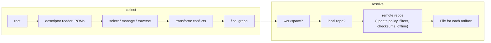

{}

Everybody uses it, some curse it, and few know what happens inside. Let's peek into how Maven Resolver gets from
"I need `org.foo:bar:1.0`" to a file on your disk.

{}

## Four phases, not one

When you say "resolve", Resolver does not do one thing. It does (up to) **four**, and each of them can be
invoked on its own via `RepositorySystem`:

1. **collect** (`collectDependencies`): builds the dependency *graph*. Only POMs (and metadata) are fetched,
   no JARs are touched.
2. **transform** (part of collect): the raw graph is turned into the final graph (conflicts resolved, scopes
   and optionality applied, etc.)
3. **flatten**: the final graph (a tree-like structure) is turned into a flat, ordered list of artifacts.
4. **resolve** (`resolveArtifacts` / `resolveDependencies`): the artifacts of that list are fetched
   (downloaded if needed) and their `File`s are made available.

`resolveDependencies` is just all four steps done as one. This is why Maven can tell you "dependency
resolution failed" in two completely different ways: a POM was missing (collect) or a JAR was missing (resolve).

## Collect: building the graph

Collection starts from a root (a `CollectRequest` with direct dependencies, managed dependencies and
remote repositories). For each node, Resolver needs to know what *that* artifact depends on. It asks the
`ArtifactDescriptorReader` for an **artifact descriptor**: in Maven land this means locating the POM of the
artifact, resolving it (yes, using the very same machinery described below), and building its effective
model: parent POMs, imports, interpolation, and so on. The result lists the dependencies, the managed
dependencies and the repositories declared by that artifact.

If the version is a range (`[1.0,2.0)`), `VersionRangeResolver` is consulted first, and the version
metadata (`maven-metadata.xml`) of the repositories is used to enumerate candidates; then a
`VersionFilter` may prune them. Each remaining version becomes a candidate node.

While walking down, the collector consults a handful of policies, all coming from the session
(`RepositorySystemSession`):

* `DependencySelector`: should this dependency be part of the graph at all? (scope, optional, exclusions)
* `DependencyManager`: apply `dependencyManagement`: override version, scope, exclusions...
* `DependencyTraverser`: should we go deeper, below this node? Nodes being "self-contained" (uber-jar, war) are stopping here.
* `VersionFilter`: which versions of a range are acceptable?

Note these are **stateful along the path**: each is "derived" as the collector descends, which is why
exclusions on one branch do not leak to its siblings. This also means that the same artifact may be reached
via many paths, with different outcomes. Resolver caches descriptors (`DataPool`) to keep this cheap.

The output of this step is a graph that is generally a "dirty" one: it may contain the same `G:A` many times
with different versions.

## Transform: making sense of the graph

The `DependencyGraphTransformer` takes the dirty graph and cleans it up. The default one is a chain:

* **conflict marker** and **conflict resolver**: for each `G:A:C:E` (conflict id) one winner is picked. The
  `VersionSelector` decides who wins, by default "nearest wins" (the shallowest in the graph, first
  declaration breaks ties), while `ScopeSelector` and `OptionalitySelector` settle the effective scope and
  optionality, and `ConflictResolver` removes the losers. Since Resolver 2 there is "highest" selector as well.
* **JavaScope / scope deriver**, **simple optionality** and so on: finishing touches.

Nearest-wins is the reason why the order of your dependencies in the POM matters, and why people sprinkle
`dependencyManagement` around: management is applied *during* collect, so it wins before conflict
resolution even starts.

After transformation, it is guaranteed we deal with a tree, as any possible cycle was removed as well.

## Flatten: from graph to list

Consumers (a compiler classpath, a WAR's `lib` directory) do not want a graph, they want a **list**. Flattening
walks the final graph with a `DependencyVisitor` (Resolver 1.x used "pre-order, Resolver 2.x uses "level-order") 
and emits each node once. `resolveDependencies` does this internally, creating one `ArtifactRequest` per node.
The visiting order is **the order of the classpath**.

## Resolve: from coordinates to a File

Now we have a final graph, and a list of artifacts to fetch. For each one, `ArtifactResolver`:

1. asks the **workspace** (`WorkspaceReader`) first. This is how reactor builds find modules that are
   not even packaged yet. If found, we are done.
2. asks the **local repository** (`LocalRepositoryManager`, LRM). If the file is present *and*
   "available" (see below), we are done.
3. otherwise for each candidate **remote repository**, in order, a `RepositoryConnector` is created and a
   download is attempted. The first success wins.

The steps are a bit more subtle than they look:

* **Snapshots and versions**: `VersionResolver` first translates `1.0-SNAPSHOT` or `LATEST`/`RELEASE` into a
  concrete version, using repository metadata (the timestamped `1.0-20260101.120000-1`).
* **Availability tracking**: the LRM does not merely check for a file: it remembers *from which repository*
  (and in which context) the file arrived. A file that came from repository A is not blindly considered as
  available for a request that asks only repository B. (The "enhanced" LRM does this, the "simple" one does not.)
* **Update policy**: for snapshots (by default `daily`), `UpdateCheckManager` decides if it's time to ask the
  remote again, and remembers *negative* results too (the infamous `*.lastUpdated` files), so a missing
  artifact is not re-requested on every build.
* **Offline**: `session.isOffline()` makes the remote step fail fast with "offline" error.
* **Repository filters**: `RemoteRepositoryFilter` may veto a repository for a given artifact before any
  network traffic occurs (this is what prefix files, groupId filtering do; and it saves lots of HTTP 404s).
* **Remote repository management**: `RemoteRepositoryManager` merges the repositories of the request with the
  ones declared in POMs (mirrors, proxies and authentication selectors apply here), so what you configured in
  `settings.xml` is applied *to every one of them*.

## The download itself

The connector (Resolver ships a basic one, plus transporters for file, HTTP, ...) fetches the artifact and
its checksums, and the `ChecksumPolicy` (`warn` / `fail` / `ignore`) tells what happens on mismatch. Trusted
checksum sources (Resolver 1.9+) may even let it skip fetching the remote checksum and compare with a
locally-known one. Downloads go to a temporary file first and are atomically moved into the final location only
when complete and verified, so an interrupted build does not poison it.

Finally, the LRM is told about the new file and "registers" it (availability tracking), so the next request is a cache hit.

## Putting it together

Also worth remembering: the whole thing is *configuration-driven* (`RepositorySystemSession` plus
configuration properties). Resolver itself implements no "Maven behavior": what Maven 3 and Maven 4
do differently is mostly a matter of how the session is **configured**, and which components are
plugged in. That is also the reason why tools like [MIMA](/blog/2024/09/07/what-is-mima-and-what-is-not/) can use the same
machinery outside of Maven.

## Important changes in Resolver 2

Recall the "availability tracking" from the resolve phase: the enhanced LRM records, in `_remote.repositories`
files next to the artifact, which repository the file came from. In Resolver 1.x that record is keyed by
the repository **id** (`central`, `my-releases`, ...). That is simple, but an id is just a string
that anyone can put into a POM:

* two unrelated projects both call their repository `project-releases`, and the local repository cannot tell them apart,
* a transitively resolved (third party, untrusted) POM declares a repository with the id `central`, but
  with a different URL, and a file from it is now "available" as if it came from Central,
* ids that are not file-system friendly end up as path segments in a split local repository.

Resolver 2 introduces the **repository key function** (SPI): a function that creates a "key" out of a
`RemoteRepository`, that is file-system friendly and configurable. Existing functions are `nid` (the
Maven 3 compatible, id-only one, still the default system-wide), `nid_hurl` (id plus hash of the URL, like
`central-<sha1(url)>`) and others, but these are the most important ones.

The tracking key is `nid_hurl` by default. Consequently, "same id, different URL" is no longer
automatically "same origin", and the transitive-POM trick above does not work anymore.

Entries written under a different function than the active one are fail-safe: the artifact merely looks
unavailable and is remote existence checked (and checksum-verified) once. Resolver also goes the extra mile for
compatibility: legacy id-only entries, and same-id entries whose URL changed (very common in integration tests
that redirect `central` to a `file:` URL), are still accepted and upgraded on the next download.
**The practical advice: if you change the key function, start with a fresh local repository.**
